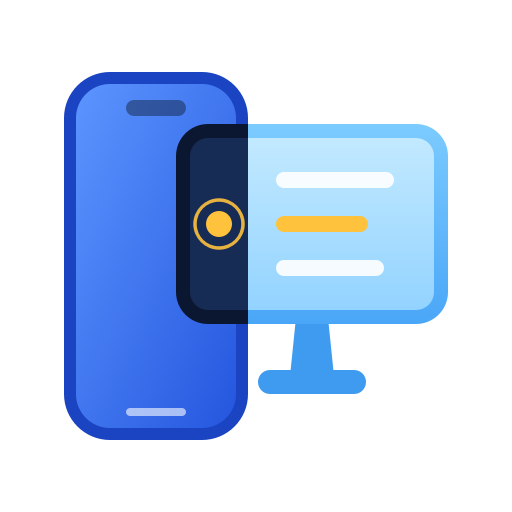
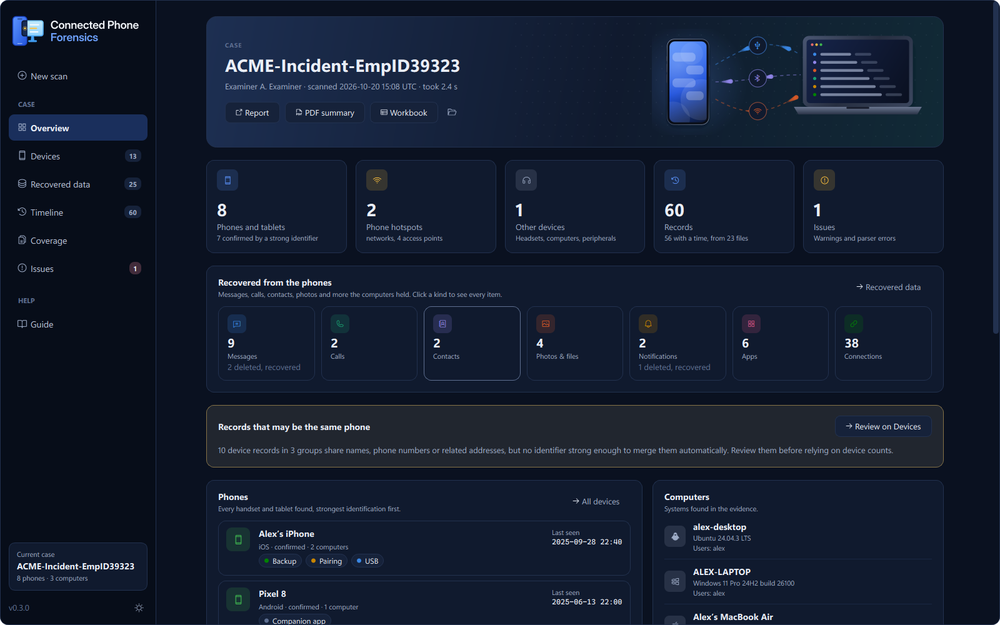
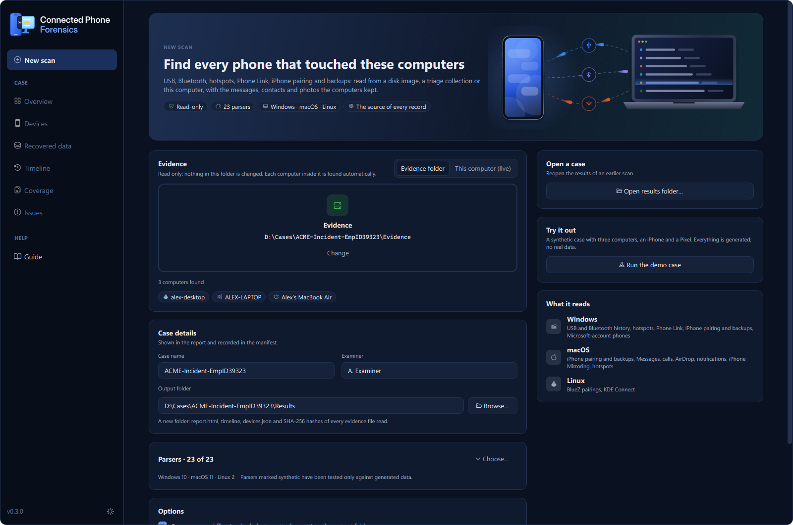
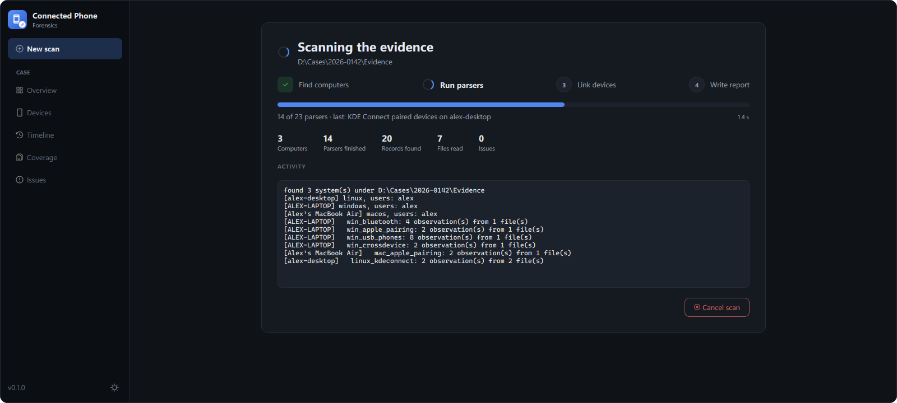
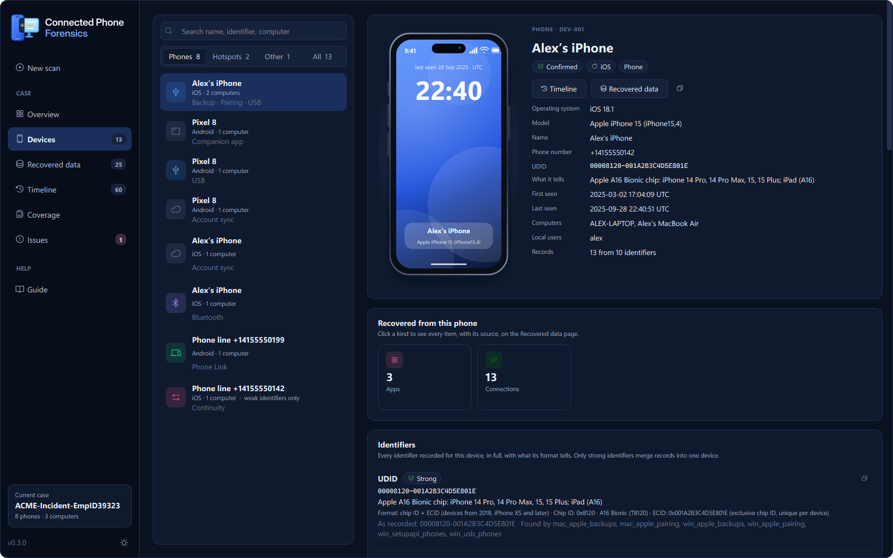
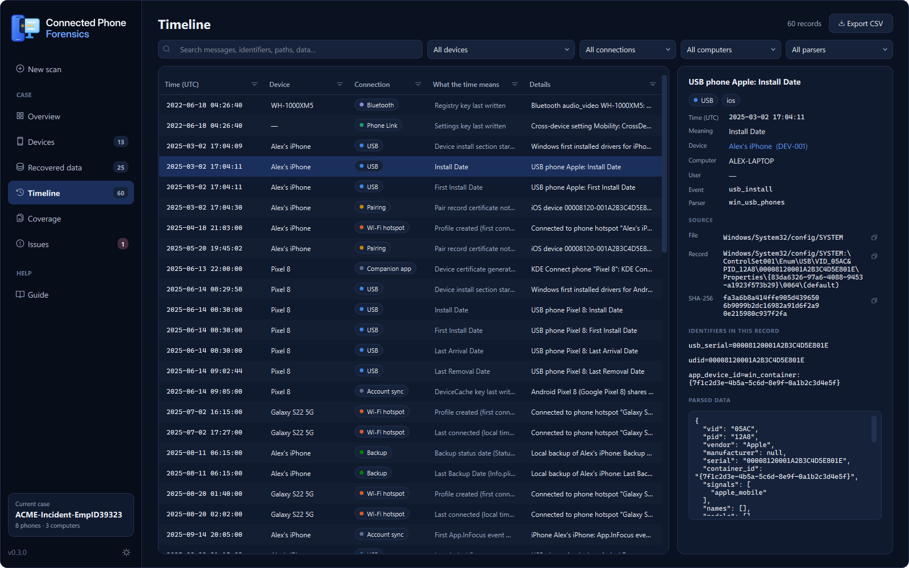
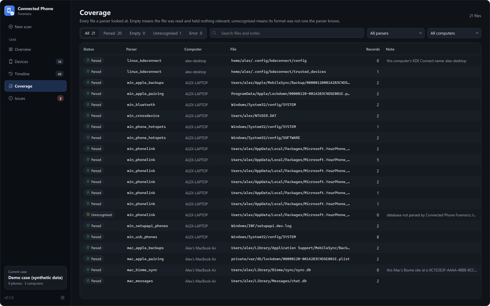
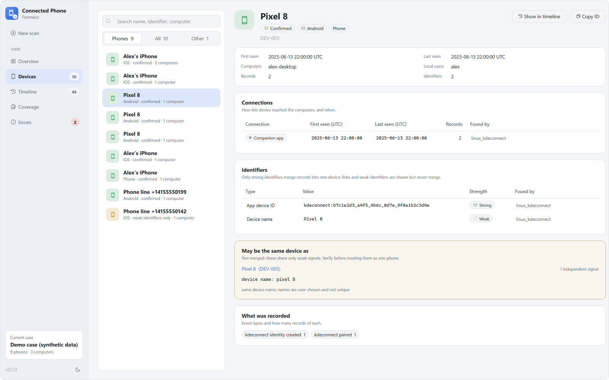
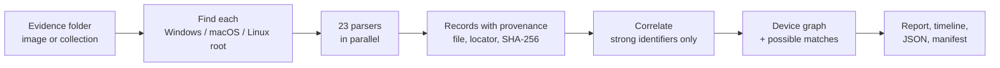

<div align="center">



# Connected Phone Forensics

**Find every phone that was connected to a computer, and show exactly where each fact came from.**

USB · Bluetooth · Wi-Fi hotspots · Phone Link · iPhone pairing and backups · Messages · AirDrop · KDE Connect<br>
from Windows, macOS and Linux disk images and triage collections.

[](https://github.com/sujayadkesar/connected-phone-forensics/releases)
[](https://github.com/sujayadkesar/connected-phone-forensics/actions/workflows/ci.yml)
[](https://pypi.org/project/connected-phone-forensics/)
[](#install-with-pip-windows-macos-linux)
[](#quick-start)
[](LICENSE)

[](https://github.com/sujayadkesar/connected-phone-forensics/releases/latest)
&nbsp;
[](#quick-start)
&nbsp;
[](docs/ARCHITECTURE.md)

<br>



</div>

## Why

Seized phones are increasingly unreadable: since iOS 18.1 a locked iPhone reboots into
Before-First-Unlock after 72 hours without use, and full-file-system extractions depend on
exploits that come and go. The suspect's computer is usually easier to examine, and phones leave a
trail on every computer they touch: pairing records, backups, USB and Bluetooth history, hotspot
connections, companion apps, synced messages and calls.

Connected Phone Forensics finds that trail and answers three questions:

- **Which phones touched this computer?** Each phone is identified by its UDID, serial, IMEI,
  Bluetooth or Wi-Fi MAC, or USB serial, and every identifier is traced to the record that holds it.
- **When, and over which connection?** USB, Bluetooth, hotspot, pairing, backup, Phone Link,
  Continuity, companion apps, with first and last seen for each.
- **What phone data is on the computer?** Messages, calls, contacts and notifications, each tagged
  with the phone it came from.

## Highlights

- **23 parsers** for Windows, macOS and Linux, run in parallel. Point it at a mounted image or a
  KAPE, Velociraptor or UAC collection and every computer inside is found automatically.
- **One device per phone, defensibly.** Records merge only through strong identifiers named
  together in one record, and each merge shows the record that caused it. Shared names, numbers
  and neighbouring MAC addresses are shown as *possible* matches and never merged silently.
- **Provenance for every fact:** source file, SHA-256 and a locator precise enough to find the
  record by hand (`SYSTEM:\ControlSet001\Enum\USB\...\0066`, `table=message rowid=42`).
- **Read-only and verifiable.** Databases and hives are read from copies, every evidence file
  read is hashed into a manifest, and nothing is skipped silently: unknown formats are reported.
- **Desktop app and command line.** A fast native app for examination, and a CLI for scripting
  and pipelines. Both write the same report, Timesketch timeline and JSON.

## Screenshots

<table>
  <tr>
    <td width="50%"></td>
    <td width="50%"></td>
  </tr>
  <tr>
    <td align="center"><b>New scan</b>: drop the evidence; the computers inside are listed before you start</td>
    <td align="center"><b>Live progress</b>: parsers run in parallel and can be cancelled</td>
  </tr>
  <tr>
    <td></td>
    <td></td>
  </tr>
  <tr>
    <td align="center"><b>Devices</b>: identifiers, connections, why records were linked</td>
    <td align="center"><b>Timeline</b>: every record with its file, locator and SHA-256</td>
  </tr>
  <tr>
    <td></td>
    <td></td>
  </tr>
  <tr>
    <td align="center"><b>Coverage</b>: every file a parser read, and what came of it</td>
    <td align="center"><b>Light theme</b></td>
  </tr>
</table>

<sub>Screenshots show the built-in demo case: entirely synthetic data.</sub>

## Quick start

### Windows: download and run

1. Download **`ConnectedPhoneForensics-<version>-windows-x64.exe`** from the
   [latest release](https://github.com/sujayadkesar/connected-phone-forensics/releases/latest).
   Nothing to install.
2. Run it. The executable is not code-signed yet, so SmartScreen may say *Windows protected your
   PC*: choose **More info → Run anyway**. Check the download against `SHA256SUMS.txt` first:
   ```powershell
   certutil -hashfile ConnectedPhoneForensics-0.1.0-windows-x64.exe SHA256
   ```
3. Click **Run the demo case** to see it work on synthetic data, or drop your evidence folder on
   **New scan**.

The same release has **`cpf-<version>-windows-x64.exe`**, the command-line tool.

### Install with pip (Windows, macOS, Linux)

```bash
pip install connected-phone-forensics
```

Then run `cpf-gui` for the desktop app or `cpf --help` for the command line. Needs Python 3.10 or
newer.

### Try it without evidence

```bash
cpf demo ./demo
```

builds a synthetic case (a Windows laptop, a MacBook and a Linux desktop that one iPhone and one
Pixel touched), scans it and writes the report to `./demo/report`. Every byte is generated.

## Usage

### Desktop app

| Page | What it shows |
|---|---|
| **New scan** | Evidence picker (drop a folder), the computers found in it, case reference, examiner, output folder, parser selection |
| **Overview** | Phones, computers, records by connection type, and records that may be the same phone |
| **Devices** | Every device: identifiers and their strength, connections with first and last seen, why its records were linked, possible matches |
| **Timeline** | All records, searchable and filterable by device, connection, computer and parser; provenance of the selected record; CSV export of what is shown |
| **Coverage** | Every evidence file read, with status `parsed`, `empty`, `unrecognised` or `error` |
| **Issues** | Parser warnings and errors, with the full message |

**Open results folder** reopens any earlier scan. Keyboard: <kbd>Ctrl</kbd>+<kbd>N</kbd> new scan,
<kbd>Ctrl</kbd>+<kbd>O</kbd> open results, <kbd>Ctrl</kbd>+<kbd>F</kbd> search,
<kbd>Ctrl</kbd>+<kbd>1</kbd>…<kbd>6</kbd> switch pages.

### Command line

```bash
cpf scan /mnt/evidence -o case42 --case 42 --examiner "A. Examiner"
```

| Command | Purpose |
|---|---|
| `cpf scan INPUT -o OUT` | Scan a mounted image, extracted drive or triage collection. Options: `--case`, `--examiner`, `--plugins`, `--workers N`, `--workdir`, `--no-export`, `--no-html`, `--assume-same` |
| `cpf demo OUT` | Build and scan the synthetic demo case |
| `cpf plugins` | List the parsers and how far each has been validated |
| `cpf targets --format kape\|velociraptor\|list` | Collection targets for exactly the files the parsers read |
| `cpf validate truth.json OUT` | Score a scan against a ground-truth file |
| `cpf docs -o artifacts.md` | Artifact reference generated from the parsers |

## What it finds

| Parser | Computer | Evidence of | Validation |
|---|---|---|---|
| `win_usb_phones` | Windows | Phones over USB (MTP/PTP/ADB/RNDIS, iPhone), install/arrival/removal times, serial/UDID, model | public sample |
| `win_setupapi_phones` | Windows | First driver install per phone, later driver installs (setupapi.dev.log) | synthetic |
| `win_bluetooth` | Windows | Bluetooth pairings (BTHPORT): name, class of device, last seen/connected, link keys; phone services offered to the PC (Hands-Free, MAP, PBAP, Apple Notification Center) | synthetic |
| `win_phone_hotspots` | Windows | Phone hotspots joined (NetworkList + DHCP; iPhone 172.20.10.0/28) | public sample |
| `win_phonelink` | Windows | Microsoft Phone Link caches: SMS/MMS, calls, contacts, notifications, photos, app list, the phone's own number; deleted and edited rows recovered from the WAL | synthetic |
| `win_wpn_phonelink` | Windows | Phone Link toasts in the Windows notification database, including recovered expired toasts | public sample |
| `win_crossdevice` | Windows | Phones known to the Microsoft account (TaskFlow DeviceCache), cross-device settings | synthetic |
| `win_apple_pairing` / `mac_apple_pairing` | Windows / macOS | iPhone trust (lockdown) records: UDID, Wi-Fi MAC, escrow keybag, pairing time | synthetic |
| `win_apple_backups` / `mac_apple_backups` | Windows / macOS | iPhone backups: identity, phone number, IMEI, apps, dates, encryption | synthetic |
| `mac_biome_sync` | macOS | iPhones syncing with the Mac through Biome: OS build, last sync, data streams received | synthetic |
| `mac_messages` | macOS | SMS relayed from the iPhone (Text Message Forwarding) and iMessage; the iPhone's number | synthetic |
| `mac_callhistory` | macOS | Calls synced from the iPhone, with the originating device name | synthetic |
| `mac_airdrop` | macOS | Files received by AirDrop, with the sender's name | synthetic |
| `mac_phone_hotspots` | macOS | Phone hotspots joined (known networks, Personal Hotspot flag, DHCP leases) | synthetic |
| `mac_notifications` | macOS | Notifications forwarded from the iPhone (inferred: the app is not installed on the Mac) | synthetic |
| `mac_knowledgec_peers` | macOS | knowledgeC sync peers (older macOS) | synthetic |
| `mac_iphone_mirroring` | macOS | iPhone Mirroring pairing, the iPhone's app inventory | synthetic |
| `linux_bluetooth` | Linux | BlueZ pairings and discovered devices | synthetic |
| `*_kdeconnect` | Linux / Windows / macOS | KDE Connect paired phones; when the app on the phone created its identity, and whether that was the Android or the iOS app | synthetic |

**Validation levels are printed in every report.** `synthetic`: tested against fixtures built from
public documentation. `public_sample`: also tested against real public data (the DFIR Artifact
Museum). `ground_truth`: tested against data created on real devices with recorded actions. See
[docs/VALIDATION.md](docs/VALIDATION.md); ground-truth datasets are the most valuable contribution
the project can receive.

## How it works



More in [docs/ARCHITECTURE.md](docs/ARCHITECTURE.md).

## How evidence is treated

- **Read-only.** SQLite databases are copied together with their `-wal` and `-shm` files and the
  copy is opened, so the original is never modified and committed WAL records are not lost. Dirty
  registry hives are recovered from their transaction logs on a copy, following the REGF
  specification: only entries that continue the hive's sequence and pass their hash checks are
  applied, and logs next to a clean hive are left alone.
- **Hashed.** Every evidence file read is SHA-256 hashed; hashes, tool version and command line go
  into `manifest.json`.
- **Nothing skipped silently.** Every file a parser opened is in the coverage table. A file whose
  format is not recognised is reported as `unrecognised`, not dropped.
- **Honest time.** All times are UTC. Local-time artifacts are converted with the time zone recorded
  in the same image. Filesystem times are labelled as such and do not set a phone's first or last
  seen.
- **Long paths.** On Windows, evidence deeper than 260 characters (common for Phone Link) is read
  with extended-length paths, so it is never mistaken for missing.

## Outputs

| File | Contents |
|---|---|
| `report.html` | Self-contained report (works offline): phones, identifiers, connections, timeline, coverage |
| `timeline.jsonl` / `timeline.csv` | Timestamped records; imports directly into Timesketch |
| `observations.jsonl` | Every record, timed or not |
| `devices.json` | The device graph, with merge reasons and possible matches |
| `coverage.csv` | Every evidence file read and its parse status |
| `manifest.json` | Run metadata, evidence hashes, warnings |

## Possible matches and examiner conclusions

Weak clues (the same device name, a phone number, MAC addresses that differ by one, a hotspot
BSSID derived from the phone's address) never merge records automatically. They are listed per pair
of devices with the number of independent signals. When an examiner has verified that two
identifiers belong to one phone, the conclusion can be recorded, and it is labelled as an examiner
assertion in the report and manifest:

```bash
cpf scan /mnt/evidence -o out --assume-same udid=00008120001A2B3C4D5E801E,bt_mac=a4:c3:37:5e:10:2b
```

## Collecting only what it needs

```bash
cpf targets --format kape > CPF.tkape
cpf targets --format velociraptor > CPF.yaml
cpf targets --format list
```

The targets are generated from the parsers' own path declarations, so a collection always matches
what the installed version can parse.

## Project status

**Early release (0.1).** The tool runs end to end on Windows, macOS and Linux, and every parser has
automated tests, but only three parsers have been checked against real public data and none yet
against ground-truth data from real phones. A code review in October 2026 found issues that are not
fixed yet, including one critical: recovery of *deleted* SQLite rows (Phone Link, Windows
notifications) can report rows from another table as recovered messages or notifications. The full
list is in the [changelog](CHANGELOG.md#known-issues).

Treat results as leads and verify them against the source records the report points to, which is
good practice with any forensic tool.

### Roadmap

- Fix the open review findings, starting with SQLite deleted-row attribution
- Ground-truth validation with real iPhone and Android devices
- Code-signed Windows builds
- Recording examiner conclusions (same phone / not the same phone) from the desktop app

## Building from source

```bash
git clone https://github.com/sujayadkesar/connected-phone-forensics
cd connected-phone-forensics
python -m venv .venv && . .venv/bin/activate      # Windows: .venv\Scripts\activate
pip install -e ".[dev]"
python -m pytest                                  # GUI tests run headless
python -m ruff check connected_phone_forensics tests
```

Windows executables: `pip install -e ".[build]"`, then `python packaging/build.py` and
`python packaging/smoke_test.py dist`. Releases are built the same way by
[GitHub Actions](.github/workflows/release.yml) when a version tag is pushed.

## Contributing

Parsers are small, self-registering modules. [CONTRIBUTING.md](CONTRIBUTING.md) describes the
plugin API and the evidence-handling rules every parser follows. Bug reports, artifact requests and
ground-truth datasets are welcome in the [issue tracker](https://github.com/sujayadkesar/connected-phone-forensics/issues).
Please report security problems privately, as described in [SECURITY.md](SECURITY.md).

## Citing

If you use Connected Phone Forensics in research or casework documentation, please cite it; GitHub
shows a citation from [CITATION.cff](CITATION.cff) under *Cite this repository*.

## License

[MIT](LICENSE). Provided as is, without warranty: validate results before relying on them in
legal proceedings.
